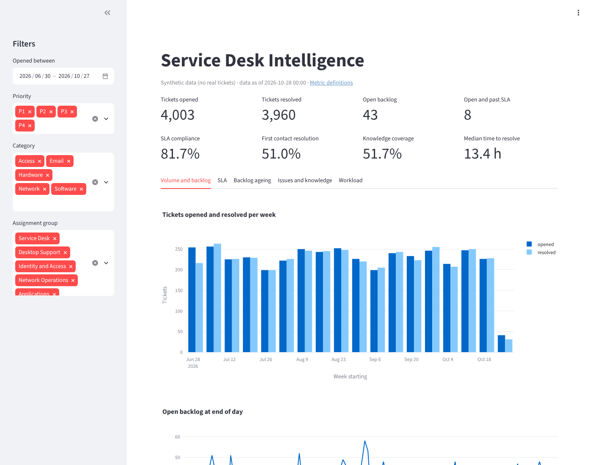

# Service Desk Intelligence Dashboard

A dashboard that turns service desk ticket data into actionable insight: volume and backlog trends, SLA health, recurring issues, and team workload.

Built with Python, Streamlit, pandas and Plotly. It runs out of the box on generated synthetic tickets, so no real ITSM data is needed to try it.



## What it shows

- **Headline figures**: tickets opened and resolved, open backlog, open tickets past SLA, SLA compliance, first contact resolution, knowledge coverage and median time to resolve.
- **Volume and backlog**: weekly opened versus resolved, daily backlog, contact channel mix.
- **SLA**: compliance and resolution times by priority, and a list of open tickets already past target.
- **Backlog ageing**: open tickets by age bucket and priority.
- **Issues and knowledge**: top recurring issues and how often they are resolved with a knowledge article.
- **Workload**: open, breached and resolved tickets per group and per assignee.

Each figure is defined in [docs/metrics.md](docs/metrics.md) and computed only from the loaded data; when there is nothing to compute from, the dashboard shows `n/a`.

## Getting started

Requires Python 3.11 or later.

```bash
git clone https://github.com/khancam15/Service-Desk-Intelligence-Dashboard.git
cd Service-Desk-Intelligence-Dashboard
python -m venv .venv && source .venv/bin/activate
pip install -r requirements.txt -e ".[dev]"
streamlit run src/service_desk_dashboard/app.py
```

Open http://localhost:8501. With no configuration the app generates 120 days of synthetic tickets.

To use your own (anonymised) export, shape it as described in [docs/data-model.md](docs/data-model.md) and point the app at it:

```bash
cp .env.example .env   # optional; never commit .env
TICKETS_CSV=data/private/tickets.csv streamlit run src/service_desk_dashboard/app.py
```

To write a synthetic dataset to disk:

```bash
sdd-generate --days 180 --seed 42 --out data/sample/tickets.csv
```

Or run it in Docker:

```bash
docker build -t service-desk-dashboard .
docker run --rm -p 8501:8501 service-desk-dashboard
```

See [docs/deployment.md](docs/deployment.md) for hosting options and what to put in place before showing real data.

## Project layout

```
src/service_desk_dashboard/
  model.py      data model: columns, allowed values, SLA targets
  generate.py   synthetic ticket generator (also the sdd-generate command)
  data.py       CSV loading and validation
  metrics.py    metric calculations, one function per dashboard view
  app.py        Streamlit dashboard
tests/          unit tests for each module and app smoke tests
docs/           data model, metric definitions, deployment
```

Run the checks locally with `ruff check . && ruff format --check . && pytest`.

## Development workflow

- `main` is protected. All changes go through a pull request with passing checks.
- Branch names: `feat/...`, `fix/...`, `chore/...`, `docs/...`.
- Commit messages follow [Conventional Commits](https://www.conventionalcommits.org/) (for example `feat: add SLA breach chart`).
- See [CONTRIBUTING.md](CONTRIBUTING.md) for details.

## Security

Ticket data can contain personal information and internal system details. Use synthetic or anonymized data for development, keep credentials in environment variables or GitHub secrets, and report vulnerabilities privately as described in [SECURITY.md](SECURITY.md).

## License

[MIT](LICENSE)
